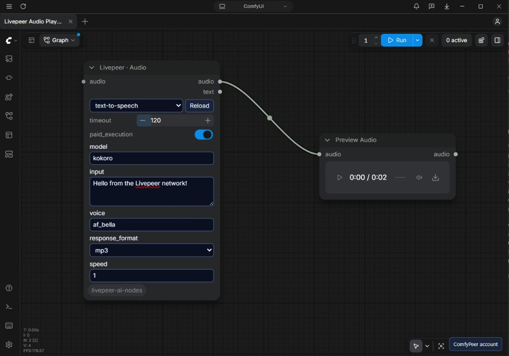

# ComfyPeer

ComfyPeer is the account for Livepeer AI Streaming in ComfyUI Desktop. Install the nodes, sign in on the canvas, and stream from your graph. Billed by the second.



## Desktop is the product, this repo is the site

ComfyUI Desktop is where a graph runs. This repository is the website: the account, billing, usage, device approval, and the install path (`/go/install` redirects to the Comfy registry). The nodes ship as Livepeer AI Streaming (`livepeer-ai-nodes`), not from this repo.

Short tagline: Stream from ComfyUI Desktop. Billed by the second.

## Stack

- Next.js 15 (App Router) · React 19 · Tailwind CSS v4
- PymtHouse Builder API (`@pymthouse/builder-sdk`) for metering & billing
- Orchestrators from SignerSession `discovery_url` (`GET /discover-orchestrators`)

## Develop

```bash
pnpm install
cp .env.example .env.local   # fill staging creds
pnpm dev
```

`NEXT_PUBLIC_APP_URL` must be the public origin (scheme + host, no path), e.g.
`http://localhost:3000` or `https://comfypeer.example`. Browser session
provisioning rejects the request when this value is missing or not a valid URL.
Production should be `https://www.comfypeer.com`.

`PYMTHOUSE_PUBLIC_CLIENT_ID` must equal `app_444013b9d984f62f5572a282` in production.
That value is public. ComfyUI Desktop also accepts it as `COMFYPEER_PUBLIC_CLIENT_ID`
or `PYMTHOUSE_CLIENT_ID`.

## Scripts

| Command          | Purpose                |
| ---------------- | ---------------------- |
| `pnpm dev`       | Local server           |
| `pnpm build`     | Production build       |
| `pnpm typecheck` | `tsc --noEmit`         |
| `pnpm lint`      | ESLint (zero warnings) |
| `pnpm test`      | `node:test` on `lib/**/*.test.ts` |

Starter workflow downloads are served from `public/workflows/` at `/go/workflow`. Livepeer AI Streaming links to those URLs. `node scripts/sync-workflows.mjs` copies this site's files into a local `livepeer-ai-nodes/workflows` checkout so the installed examples match. The script refuses home paths, credential-shaped secrets, and `eliteencoder.net`.

## Design system

See `design-system/MASTER.md` and `design-system/pages/*`.

## Deploy

Set every variable in `.env.example` on the host. In particular:

- `NEXT_PUBLIC_APP_URL` — public origin used for CSRF origin/referer checks.
  Provisioning fails closed if it is unset or invalid. Do not fall back to
  localhost in production.
- `COMFYPEER_SESSION_SECRET` — HMAC key for `__Host-comfypeer_session`. Bump
  `SESSION_VERSION` in `lib/session.ts` to invalidate existing cookies after a
  suspected leak (clearing the cookie alone cannot revoke a copied token).
- Auth0 and PymtHouse credentials as listed in `.env.example`.

The session cookie uses the `__Host-` prefix (Secure, `Path=/`, no Domain).
The app must be served over HTTPS, or over `localhost` for local development.

## Orchestrator discovery

ComfyPeer mints an owner SignerSession and uses the suggested `discovery_url`
(default `{signer_url}/discover-orchestrators`). `ORCH_URL` / `ORCH_URLS` are unused.
